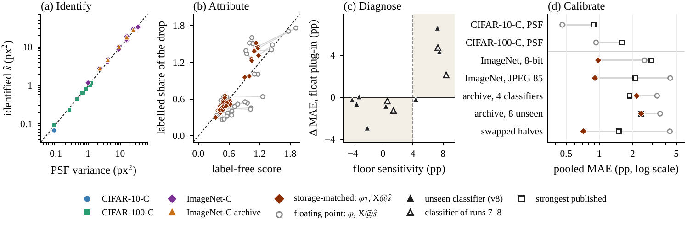
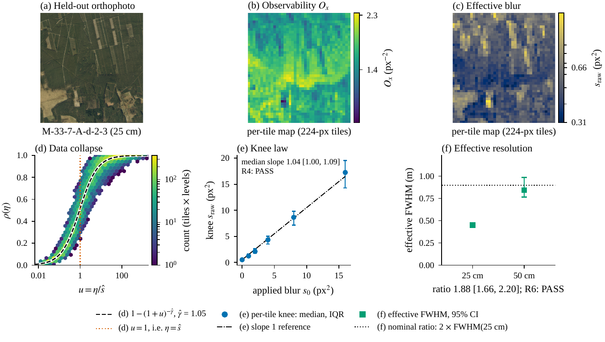
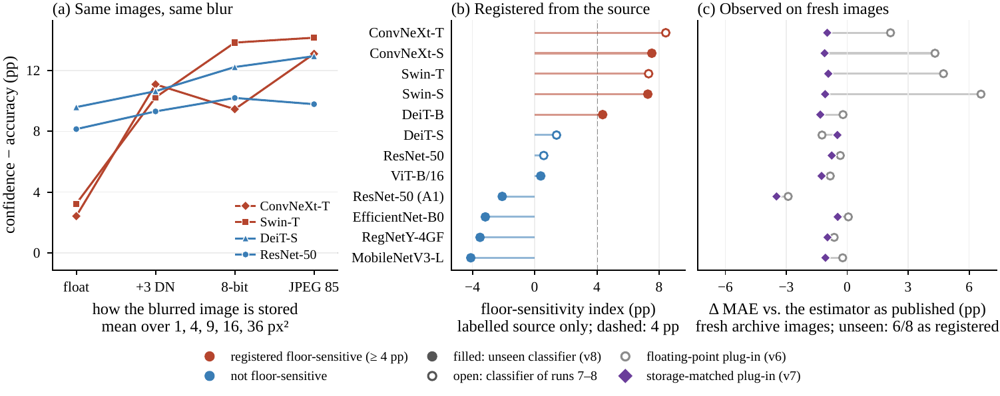

<div align="center">

# Re-Degradation Reveals Resolution

### Label-Free Identification and Attribution of Blur Shift

**Anonymous CVPR 2027 submission** &nbsp;·&nbsp; Paper ID \*\*\*\*\*

[](#citation)
[](#installation)
[](tests)
[](pyproject.toml)
[](prereg)
[](docs/REPRODUCE.md)
[](docs/DATA.md)
[](LICENSE)



[**TL;DR**](#tldr) &nbsp;·&nbsp; [**How it works**](#how-it-works) &nbsp;·&nbsp; [**Results**](#results) &nbsp;·&nbsp; [**Quick start**](#quick-start) &nbsp;·&nbsp; [**Reproducing**](#reproducing-the-paper) &nbsp;·&nbsp; [**Runs**](notebooks/README.md) &nbsp;·&nbsp; [**Registration**](#registration) &nbsp;·&nbsp; [**Citation**](#citation)

<sub>The three graphics are animated SVGs built from the paper's equations and numbers. Sections marked <kbd>▶ click to expand</kbd> open in place.</sub>

</div>

## TL;DR

Images that reach a deployed classifier are often blurrier than the labelled images it was validated on: another sensor, a
coarser ground sample distance, an oblique view or lossy storage is enough. Gaussian blurs add in variance, so re-blurring an
unlabelled image by a known amount `η` removes a fraction `ρ(η)` of its gradient energy that depends on the blur it already
carries. Calibrated on the labelled source, this gives the blur as a **point-spread-function variance `ŝ` in px²**, from
pixels alone and the same for every classifier. Re-degrading the labelled source to `ŝ`, through the target's 8-bit and
JPEG storage read from its files, then says **how much of a classifier's confidence drop the blur explains** and gives a
label-free accuracy estimator **a calibration set that looks like the target**.

| | What we show | Evidence |
|---|---|---|
| 🔍 **Identify** | `ŝ` orders blur levels against a physical truth the method never used | Spearman ≥ 0.98 on CIFAR-10-C, CIFAR-100-C, ImageNet-C, fMoW resolutions and SpaceNet off-nadir views; 5 ms per image, where KernelGAN needs 41 s and, on tiles with known blur, errs 2.7 times more |
| 🧩 **Attribute** | the label-free share `φ` of the confidence drop due to blur ranks the labelled share of the accuracy drop | Spearman 1.00, 0.98 and 0.88 on fresh, storage-matched and unseen-classifier settings |
| 🎯 **Calibrate** | a published estimator, recalibrated on the re-degraded source | ATC: 22.7 → 2.1 pp on synthetic blur; on ImageNet, once 8-bit and JPEG storage are reproduced, the plug-in beats or ties the strongest published estimator |
| 🩺 **Diagnose** | a floor-sensitivity index from the labelled source alone | anticipates which classifiers a floating-point re-degradation hurts: 6 of 8 unseen classifiers as registered |
| 🔒 **Registered** | method and decision rules hashed before the runs that tested them | 8 documents, 109 rules; 54 pass, 13 partial, **14 fail**, 28 reported, all in the ledger |

It does **not** help on real cross-dataset shifts, where blur is a minor part of the shift; there the switch stays out of
the way.

## How it works

<div align="center"></div>

<sub>**Pipeline (Fig. 2), animated.** Orange: pixels and file headers only, identical for every classifier. Blue: the labelled
source, blurred to the identified level and stored like the target. Green: what the frozen classifier is used for; the
floor-sensitivity index (FSI) needs no target data.</sub>

1. **Exact re-degradation.** `T_s = exp(−sL/2)`, with `L` the Laplacian of the pixel grid with reflecting boundaries,
   multiplies each DCT coefficient by `exp(−sλ/2)`. It is exact on the finite tile, `T_s T_η = T_{s+η}`, and `s` is the
   Gaussian PSF variance in px² (Eq. 1).
2. **Response.** `ρ_x(η) = 1 − ‖D T_η x‖² / ‖D x‖²` is invariant to per-image gain and offset, is a Laplace transform of the
   gradient spectrum (so it identifies the blur unless the content is narrowband) and, for power-law spectra, follows the
   knee law `1 − (1 + η/s₀)^(−γ)`: a re-blur by `s₀(2^{1/γ} − 1)` removes half of the gradient energy, which is close to the
   existing blur `s₀` for natural images (`γ ≈ 1`) (Eq. 2, Lemma 1, Theorem 2, Corollary 1).
3. **Identification.** A knee fit on 13 re-blur levels per image; `CAL(s)` = median knee of the source blurred to `s`;
   `ŝ = CAL⁻¹(median target knee)`. A Mann-Whitney fit check flags targets that blur alone does not explain, and a
   noise-aware path then estimates `(ŝ, σ̂)` (Sec. 4).
4. **Re-degraded source.** `D(x) = JPEG_{q,c}(Q₈(T_ŝ x + σ̂ ξ))`, with quality `q` and chroma subsampling `c` read from the
   quantisation tables and sampling factors of the target files. It yields the attribution score
   `φ = (c_src(0) − c_src(ŝ, σ̂)) / (c_src(0) − c_tgt)` (Eq. 3), the plug-ins `X@ŝ` of seven published estimators (identities
   when `ŝ = σ̂ = 0` on floating-point and lossless targets; a switch uses them only when `φ ≥ 0.5`) and, from the source
   alone, the floor-sensitivity index (Eq. 4).

<details>
<summary><b>📐 Notation</b> &nbsp;·&nbsp; every symbol on this page and where the paper defines it &nbsp;<kbd>▶ click to expand</kbd></summary>
<br>

| Symbol | Meaning | Paper |
|---|---|---|
| `s`, `s₀` | blur level: the variance of a Gaussian PSF in px² (`σ_px²` for a PSF of standard deviation `σ_px`); `s₀` is the blur the target already carries | Sec. 3 |
| `T_s` | exact blur by `s` (heat semigroup, applied in the DCT domain); `T_s T_η = T_{s+η}` | Eq. 1 |
| `η` | known re-blur applied on top of an image; 13 geometric levels in [0.25, 1024] px² | Sec. 4 |
| `ρ_x(η)` | fraction of the gradient energy that the re-blur removes | Eq. 2 |
| `γ` | exponent of the knee law `1 − (1 + η/s₀)^(−γ)`; `γ ≈ 1` for natural images | Thm. 2, Cor. 1 |
| `ŝ` | identified blur level, `CAL⁻¹(median target knee)` | Sec. 4 |
| `σ̂` | noise level in DN (digital numbers, 0-255 scale) kept by the noise-aware path | Sec. 4 |
| `D(x)` | storage-matched re-degradation `JPEG_{q,c}(Q₈(T_ŝ x + σ̂ ξ))` of a source image | Sec. 4 |
| `φ`, `φ₇` | label-free share of the confidence drop due to blur; `φ₇` uses `D` in the numerator | Eq. 3 |
| `X@ŝ` | estimator X recalibrated on the re-degraded source | Sec. 4 |
| FSI | floor-sensitivity index, from the labelled source alone; ≥ 4 pp predicts that a floating-point re-degradation raises the estimators' error | Eq. 4 |
| v1.0 … v8 | the eight registration documents; in figure labels v2 is the noise-aware path, v6 the floating-point plug-in, v7 the storage-matched one | Sec. 5 |

</details>

## Results

<div align="center"></div>

<sub>**At a glance, animated.** Identification (Table 1), attribution (Sec. 6.2), calibration (Sec. 6.3, Table 2), diagnosis
(Table 3), registration (Table 4) and the nine runs (Sec. 5). All numbers in this section are copied from the paper and
come from [`results/`](results), the outputs of the final run.</sub>

<div align="center"></div>

<sub>**Fig. 1 · Overview of the evidence.** (a) *Identify*: blur level `ŝ` estimated from unlabelled pixels against the
Gaussian-equivalent PSF variance of standard corruptions (CIFAR-10-C and CIFAR-100-C official files, the ImageNet-C
definitions applied to ImageNetV2, three disjoint sets of the ImageNet-C blur archive); Spearman ρ ≥ 0.99 per benchmark.
(b) *Attribute*: label-free score against the labelled share of the accuracy drop explained by the identified blur, with a
floating-point source (`φ`, open) and a storage-matched source (`φ₇`, filled); for `φ₇`, ρ = 0.98 on the settings of run 8
and 0.88 on the unseen classifiers. (c) *Diagnose*: the floor-sensitivity index, computed on the labelled source alone,
against the observed change of error caused by the floating-point plug-in on fresh archive images; shaded: quadrants where
the prediction holds; unseen classifiers: 6 of 8 as registered. (d) *Calibrate*: pooled MAE of the strongest published
estimator, the floating-point and the storage-matched plug-in. "v8" and "runs 7-8" are registration rounds.</sub>

**Table 1 · Identification against a physical truth.** `ρS`: Spearman correlation between `ŝ` and the truth over `n`
conditions (fMoW: GSD conditions; SpaceNet: views other than the 7° control). Rel. err.: median `|ŝ − s₀| / s₀`; the
archive rows tie because `ŝ` is quantised.

| Benchmark | Truth | n | ρS | Rel. err. |
|---|---|---:|---:|---:|
| CIFAR-10-C (official) | PSF var. | 10 | 0.99 | 0.06 |
| CIFAR-100-C (official) | PSF var. | 10 | 0.99 | 0.05 |
| ImageNet-C defs., JPEG 85 | PSF var. | 10 | 1.00 | 0.12 |
| ImageNet-C defs., 8-bit | PSF var. | 10 | 1.00 | 0.14 |
| ImageNet-C archive | PSF var. | 5 | 1.00 | 0.12 |
| ImageNet-C archive, fresh | PSF var. | 5 | 1.00 | 0.12 |
| fMoW, real views | GSD | 21 | 0.98 | – |
| SpaceNet MVOI, real views | off-nadir | 26 | 0.99 | – |

Against KernelGAN on the same images, `ŝ` has the lower relative error on 40 LandCover.ai tile-level pairs with known blur
(0.37 vs. 1.00) and the higher per-image correlation with fMoW GSD (0.94 vs. 0.39), at 0.005 s instead of 41 s per image.

<details>
<summary><b>🔎 What <code>ŝ</code> is not</b> &nbsp;·&nbsp; where other identifiers win, and where the fit check fires &nbsp;<kbd>▶ click to expand</kbd></summary>
<br>

A feature regressor trained on the source at every blur level and at the test noise level is more accurate on synthetic blur
(median relative error 0.019 vs. 0.026 clean, 0.011 vs. 0.037 noisy), and the spectral slope is best on clean in-domain blur
(0.002) but fails with noise (0.77). `ŝ` needs no training, is the same for every classifier and transfers to blur no
training set contained. The fit check flags 72-80% of the 8-bit ImageNet blur sets and every defocus archive set at any size
from 125 to 2,000 images, a real misfit of the 8-bit floor and of disk PSFs; the noise-aware path keeps the error at
0.12-0.14 there.

</details>

<details>
<summary><b>🧪 The theory on real images</b> &nbsp;·&nbsp; Fig. 3, LandCover.ai orthophotos &nbsp;<kbd>▶ click to expand</kbd></summary>
<br>
<div align="center"></div>

On held-out LandCover.ai orthophotos the responses collapse onto the knee law, the median per-tile exponent is
γ̂ = 1.08 [1.00, 1.18], as Corollary 1 predicts for natural images, the knee grows one-for-one with the applied blur (slope
1.04 [1.00, 1.09]), and the most sensitive re-blur sits where Corollary 1 puts it. The 50 cm product is effectively
1.88 [1.66, 2.20] times coarser than the 25 cm product, against a nominal factor of 2. On synthetic `|ω|^(−α)` fields the
half-energy points are 0.72, 0.96, 1.49 and 3.42 times the blur for α = 1.5, 2, 2.5 and 3 (predicted: 0.74, 1.00, 1.52,
3.00); [`tests/test_theory.py`](tests/test_theory.py) reproduces these four numbers exactly from the keyed random streams of
the run. One theory-driven rule failed: per-image observability does not predict per-image identification error, so
Theorem 2(b, d) are population and obstruction statements, not a per-image reliability score.

</details>

**ImageNet needs the storage step.** On blurred ImageNetV2 targets stored as JPEG 85 the floating-point plug-in raised the
error of all seven estimators (ATC from 2.5 to 7.1 pp). A target that was blurred and then rounded to 8 bits is not
`T_s x`: rounding re-introduces a noise floor that a floating-point source lacks, and some classifiers react to it more than
to the blur. Reproducing the storage reverses the result.

**Table 2 · ImageNet with storage matching.** Pooled MAE (pp, after temperature scaling) of the strongest floating-point
plug-in (Float: COTT@`ŝ`), the strongest storage-matched plug-in (Stor.: COTT@`ŝ`; COT@`ŝ` on the two archive sets) and the
strongest of 12 published estimators (Publ.: NucNorm on lossless and archive sets, COTT otherwise). `Δ`: storage-matched
minus published with 95% bootstrap interval; **B**etter / **T**ie / **W**orse. IN-C: ImageNet-C; RS: remote-sensing
dataset pairs.

| Target set | Float | Stor. | Publ. | Δ [95% CI] | |
|---|---:|---:|---:|---|:---:|
| IN-C defs., lossless | 2.57 | **0.98** | 2.97 | −2.00 [−2.61, −1.38] | B |
| IN-C defs., JPEG 85 | 4.40 | **0.91** | 2.12 | −1.21 [−1.57, −0.79] | B |
| Archive, fresh | 3.34 | 2.18 | 1.88 | +0.31 [−0.30, +1.03] | T |
| Swapped halves | 4.37 | **0.72** | 1.50 | −0.78 [−1.14, −0.40] | B |
| Archive, unseen clf. | 3.55 | 2.40 | 2.39 | +0.01 [−0.55, +0.77] | T |
| RS pairs, JPEG | 7.43 | 8.12 | 7.29 | +0.83 [+0.06, +1.47] | W |
| RS pairs + blur | 7.62 | 7.62 | 6.76 | +0.86 [−0.81, +3.39] | T |

<div align="center"></div>

<sub>**Fig. 4 · The storage floor.** (a) Confidence minus accuracy on the same ImageNetV2 targets at the same Gaussian variance
(mean over 1, 4 and 16 px²) after a floating-point blur, the same blur with 3 DN noise, 8-bit storage and JPEG 85. (b) FSI
of every ImageNet classifier, computed on the labelled source alone (filled: the eight unseen classifiers, registered before
their targets were read; open: the four whose behaviour defined the index); dashed: 4 pp threshold. (c) On ImageNet-C
archive images no earlier run had used: change of the mean error of seven estimators caused by the floating-point (open,
v6) and the storage-matched (filled, v7) plug-in.</sub>

**Table 3 · Floor sensitivity of ImageNet classifiers.** FSI (pp, labelled source only) and its registered prediction; `Δ`:
observed change of the mean error of seven estimators (pp) caused by the floating-point and the storage-matched plug-in on
archive images not used before.

| Classifier | Role | FSI | Predicted | Δ float | Δ storage | Hit |
|---|---|---:|---|---:|---:|:---:|
| ConvNeXt-T | defining | +8.4 | harm | +2.13 | −0.99 | ✓ |
| Swin-T | defining | +7.3 | harm | +4.74 | −0.93 | ✓ |
| DeiT-S | defining | +1.4 | no harm | −1.24 | −0.49 | ✓ |
| ResNet-50 | defining | +0.6 | no harm | −0.34 | −0.76 | ✓ |
| ConvNeXt-S | unseen | +7.5 | harm | +4.32 | −1.12 | ✓ |
| Swin-S | unseen | +7.3 | harm | +6.59 | −1.09 | ✓ |
| DeiT-B | unseen | +4.4 | harm | −0.21 | −1.33 | ✗ |
| ViT-B/16 | unseen | +0.4 | no harm | −0.84 | −1.26 | ✓ |
| ResNet-50 (A1) | unseen | −2.1 | no harm | −2.91 | −3.48 | ✓ |
| EfficientNet-B0 | unseen | −3.2 | no harm | +0.05 | −0.47 | ✗ |
| RegNetY-4GF | unseen | −3.5 | no harm | −0.64 | −0.97 | ✓ |
| MobileNetV3-L | unseen | −4.1 | no harm | −0.23 | −1.07 | ✓ |

The eight unseen classifiers were registered in
[`prereg/b27_registration_record.json`](prereg/b27_registration_record.json) fifteen minutes into the final session, before
any of their target images was read: 6 of 8 as predicted (registered target: 7), rank correlation 0.52, so the index is a
warning sign rather than a rule. The storage-matched plug-in lowered the error for all twelve classifiers, by 0.47 to
3.48 pp.

**Table 4 · Registered claims.** Verdicts of the tests of each claim; documented limits are reported but not counted as tests.

| Claim | Pass | Partial | Fail | Documented limits |
|---|---:|---:|---:|---|
| C1 Identification in px² | 15 | 0 | 0 | – |
| C2 Attribution by φ | 3 | 0 | 0 | – |
| C3 Plug-in, matched pipeline | 9 | 8 | 0 | – |
| C4 No harm by construction | 5 | 1 | 0 | – |
| C5 Boundaries, diagnosis | 3 | 2 | 0 | 8 fail, 1 partial |

Of all 109 rules, 54 passed, 13 partially passed, 14 failed and 28 were reported without a threshold
([ledger](results/tables/T33a_ledger.csv)). Every figure and table of the paper and the supplement, with its source file:
[`results/README.md`](results/README.md).

## Installation

```bash
# from the repository root
python -m pip install -e ".[dev]"     # numpy, scipy, pillow; POT (for COT and COTT), pytest and ruff
python -m pytest                      # 73 tests, a few seconds on a CPU
```

Python ≥ 3.10. `pip install -e .` installs the package alone and `".[ot]"` adds POT. The package needs no GPU and no
deep-learning framework; classifiers enter only through their logits.

## Quick start

```python
from redeg import BlurIdentifier, read_store, redegrade

ident = BlurIdentifier().fit(source_tiles)      # labelled source, uint8 (n, 224, 224, 3); the labels are not needed
res = ident.identify(target_tiles)              # unlabelled target set
print(res.s_hat, res.flagged)                   # blur level in px^2; True if blur alone does not explain the target
print(res.s5, res.sigma5)                       # level and noise used to re-degrade the source (noise-aware path)

store = read_store(target_files)                # {'kind': 'jpeg', 'q': 85, 'sub': 2, ...} read from the files
source_like_target = redegrade(source_tiles, res.s5, res.sigma5, store)   # D(x) = JPEG_85(Q8(T_s5 x + sigma5 xi))
```

[`examples/quickstart.py`](examples/quickstart.py) runs this on synthetic natural-image tiles (`|ω|^−2` spectra) whose true
blur is a Gaussian PSF of variance 6 px², formed three ways:

```text
$ python examples/quickstart.py
target formation                        s_hat  flagged     s5  sigma5  storage read from the target
blur 6 px^2, floating point              5.91       no   5.91    0.00  float
blur 6 px^2 + 2 DN noise, 8-bit          0.00      yes   6.01    2.01  lossless8
blur 6 px^2, 8-bit, JPEG files           0.66      yes   5.39    0.00  JPEG q85 4:2:0
```

The blur-only level is right when the target is pure blur; noise and storage push it down, the fit check flags them, and the
noise-aware path recovers the blur (and the 2 DN noise) for the level actually used. On your own images:

```bash
redeg identify --source path/to/labelled_images --target path/to/new_images
redeg storage path/to/new_images       # 8-bit or JPEG, quality and chroma subsampling read from the files
```

<details>
<summary><b>🧰 API at a glance</b> &nbsp;·&nbsp; every function, with the equation it implements &nbsp;<kbd>▶ click to expand</kbd></summary>
<br>

| Step | Function | Paper |
|---|---|---|
| exact blur, gradient spectrum | `heat(x, s)`, `spectra(tiles)` | Eq. 1 |
| response, sensitivity, observability | `rho_curves`, `drho_ds0`, `observability`, `narrowband_index` | Eq. 2, Thm. 2 |
| identification (v1.0 + noise-aware v2) | `BlurIdentifier().fit(src).identify(tgt)`, `calibrate`, `identify_spectra`, `noise_model_pvalue` | Sec. 4 |
| storage read from files, re-degradation | `read_store`, `jpeg_file_store`, `redegrade` | Sec. 4 |
| temperature scaling | `fit_temperature`, `softmax_T` | Sec. 4 |
| attribution, switch, blend | `attribution_score`, `switch`, `blend`, `labelled_share` | Eq. 3 |
| published estimators and plug-ins `X@ŝ` | `redeg.estimators`, `plugins_at_level`, `bias_transfer` | Sec. 4 |
| floor-sensitivity index | `floor_sensitivity_index`, `fsi_inputs`, `predicts_harm` | Eq. 4 |
| closed forms of the theory | `redeg.theory` (knee law and its bound, half-energy point, two-point bound) | Thm. 2, Cor. 1, Thm. 4 |

Every constant is the registered one ([`src/redeg/constants.py`](src/redeg/constants.py)). The method and its documentation:
[`docs/METHOD.md`](docs/METHOD.md).

</details>

## Reproducing the paper

The experiments are a single Kaggle notebook, extended once per registration document and run nine times on one NVIDIA T4.
Folder `notebooks/EXPk` is run k: the executed notebook with every output, and the `outputs.zip` that the run wrote.
**[`notebooks/EXP9/EXP9_v8_final.ipynb`](notebooks/EXP9) produced every number, table and figure of the paper** from its
own checkpoints; runs 1-8 are kept as the record of each run ([`notebooks/README.md`](notebooks/README.md)).

| Run | 1 | 2 | 3 | 4 | 5 | 6 | 7 | 8 | 9 |
|---|---|---|---|---|---|---|---|---|---|
| Folder | [`EXP1`](notebooks/EXP1) | [`EXP2`](notebooks/EXP2) | [`EXP3`](notebooks/EXP3) | [`EXP4b`](notebooks/EXP4b)\* | [`EXP5`](notebooks/EXP5) | [`EXP6`](notebooks/EXP6) | [`EXP7`](notebooks/EXP7) | [`EXP8`](notebooks/EXP8) | [`EXP9`](notebooks/EXP9) |
| Registration | v1.0 | v2 | v3 | v4 | v5 | v6 | v6 | v7 | v8 |
| New blocks | v1.0 programme | B2-B4, B6 | B9-B11 | B12 | B13-B17 | B19-B23 | B18 | B24-B26 | B27 + paper |

<sub>\* [`EXP4a`](notebooks/EXP4a) is a first attempt at run 4 that could not download the CIFAR-10 data; it is kept as part
of the record and nothing it wrote was used. To fit GitHub's 25 MiB upload limit, some zips are stored without their figure
files (PDF and PNG); every entry they keep is byte-identical, and the final run's 41 figures are in
[`figures/`](figures).</sub>

```bash
python scripts/verify_prereg.py                          # recompute the 8 registration hashes and the B27 record: ALL HASHES MATCH
python scripts/check_notebook_equivalence.py \
       --notebook notebooks/EXP9/EXP9_v8_final.ipynb     # package vs. notebook code on keyed inputs: ALL IDENTICAL
```

The second command extracts the method's definitions from the notebook (without running it) and checks the package against
them: all 61 compared quantities are bit-identical, including the published half-energy table of block B1. To rerun the
experiments themselves (Kaggle, about 40 GPU-hours from scratch, resumable across 11-hour sessions), see
[`docs/REPRODUCE.md`](docs/REPRODUCE.md). Datasets and models are public and downloaded by the notebook; no credentials are
used ([`docs/DATA.md`](docs/DATA.md)).

## Registration

The method, its constants and 24 decision rules were frozen in a document (v1.0) before any evaluation; seven addenda (v2-v8)
added rules or method extensions, each hashed and stored before the run that tested it. Every rule has a threshold and a
verdict, and every verdict is reported, failures included ([`results/tables/T33a_ledger.csv`](results/tables/T33a_ledger.csv)
ff.). [`prereg/`](prereg) contains the eight documents, their hashes and the B27 registration record;
`python scripts/verify_prereg.py` recomputes every hash and ends with **`ALL HASHES MATCH`**.

<details>
<summary><b>🔐 Full output of <code>verify_prereg.py</code></b> &nbsp;·&nbsp; 8 hashes, 8 registered predictions &nbsp;<kbd>▶ click to expand</kbd></summary>
<br>

```text
$ python scripts/verify_prereg.py
document   frozen                      SHA-256 (recomputed)                                               paper  list  manifest
v1.0       before run 1                58594e8ccc059e4827b22061855cf0a139958113e5e114cce963d1b8b6aebfb5    ok    ok    ok
v2         after run 1, before run 2   9e3ab0852200bfaabed8b711ad71453836e2649c981f3f92b84836781c863998    ok    ok    ok
v3         after run 2, before run 3   86ab550b0b1a2024c8dbfee00a6a7cd1014aca3c0993acc13fc9af1b07420faf    ok    ok    ok
v4         after run 3, before run 4   b885f994c5d840ee714668860f7e21f12ab71f673ef360be6319e2a72639d209    ok    ok    ok
v5         after run 4, before run 5   ecec36131e8b3e7755ece91f6548e338b88522c163c9eb7f8d481011de57fc3c    ok    ok    ok
v6         after run 5, before run 6   b66b2997d9861bb358d2beb4de7f3ed3e64e2cc7ad214f2a7e31c2ddc97d6580    ok    ok    ok
v7         after run 7, before run 8   be1de05049d2b835c2e538ed57429bd3a4cd4da4d34c560908a4d53f8af9b131    ok    ok    ok
v8         after run 8, before run 9   9dbd90fa80627c4f47f9a9076d6c2c67e178cbb97912f834a29f1260bb027cb2    ok    ok    ok

B27 registration record (created 2026-10-21T00:53:13, before any target image was read: True)
  SHA-256 recomputed from the 8 registered indices: e7c59048e412a5a376e40d5fbc241323e264ba02abfd1979bc09c583bd57078b  ok
    convnext_small.fb_in1k                        FSI   +7.53 pp  ->  harm     (threshold 4 pp)
    swin_small_patch4_window7_224.ms_in1k         FSI   +7.27 pp  ->  harm     (threshold 4 pp)
    deit_base_patch16_224.fb_in1k                 FSI   +4.37 pp  ->  harm     (threshold 4 pp)
    vit_base_patch16_224.augreg2_in21k_ft_in1k    FSI   +0.39 pp  ->  no harm  (threshold 4 pp)
    resnet50.a1_in1k                              FSI   -2.09 pp  ->  no harm  (threshold 4 pp)
    efficientnet_b0.ra_in1k                       FSI   -3.17 pp  ->  no harm  (threshold 4 pp)
    regnety_040.ra3_in1k                          FSI   -3.51 pp  ->  no harm  (threshold 4 pp)
    mobilenetv3_large_100.ra_in1k                 FSI   -4.11 pp  ->  no harm  (threshold 4 pp)

ALL HASHES MATCH
```

</details>

The timestamps and hashes are our own record, so the registration is a commitment device that makes later changes visible,
not an external audit; the claims map was revised twice after some of the verdicts it reassigns were known (all three maps
are in the supplement and the ledger).

## Repository structure

```text
redeg/
├── src/redeg/              the method as a package (numpy / scipy / pillow); constants as registered
│   ├── semigroup.py        exact DCT heat semigroup, binned gradient spectra                    Eq. 1
│   ├── response.py         response rho(eta), sensitivity identity, observability               Eq. 2, Thm. 2
│   ├── knee.py             knee fit, v1.0 joint blur+noise fit, v1.1 tail fit
│   ├── identify.py         calibration, s_hat, fit check, noise-aware path, BlurIdentifier      Sec. 4
│   ├── storage.py          storage read from files, Q8 / JPEG, re-degraded source D(x)          Sec. 4
│   ├── estimators.py       AC, DoC, ATC, ATC-NE, NucNorm, COT, COTT, MaNo
│   ├── plugins.py          plug-ins X@s_hat (identity-preserving forms), bias transfer          Sec. 4
│   ├── calibration.py      temperature scaling
│   ├── attribution.py      phi, switch, blend                                                   Eq. 3
│   ├── fsi.py              floor-sensitivity index                                              Eq. 4
│   ├── theory.py           knee law and bound, half-energy point, two-point bound               Thm. 2, Cor. 1, Thm. 4
│   ├── io.py, cli.py       image loading as in the experiments; `redeg identify`, `redeg storage`
├── tests/                  73 tests: theory checks, identification, storage, estimators, registration, tooling,
│                           and the package against outputs of the notebook's own code (fixtures/)
├── notebooks/              EXP1-EXP9: the executed notebook and outputs.zip of each run (EXP9 = the paper)
├── prereg/                 the eight registration documents, their SHA-256, the B27 registration record
├── results/                outputs of the final run: 46 tables (CSV), key results, run manifest, full log
├── figures/                the 41 figures of the paper and the supplement (PDF) with PNG previews
├── scripts/                verify_prereg, check_notebook_equivalence, prepare_notebooks, check_anonymity
├── examples/quickstart.py  identification and re-degradation on synthetic tiles
├── docs/                   METHOD.md, REPRODUCE.md, DATA.md
└── assets/                 graphics of this README (animated SVG) and paper figures
```

## Limitations

The identification guarantees cover Gaussian blur with per-image gain and offset; white noise enters only the minimax bound
(Theorem 4) and the heuristic noise-aware path, and other PSFs enter only through their second moment. Label shift is
invisible to pixels, and on real cross-dataset pairs the plug-ins do not beat the best published estimator. Identification
is a population statement (per-image estimates saturate for strong blur), the floor-sensitivity index was supported by 6 of
8 held-out classifiers, and we studied classification at 224 px with frozen encoders and ImageNet classifiers, not
fine-tuning, detection or segmentation; a single T4 GPU limited most datasets to one seed. The re-degradation must reproduce
the whole imaging pipeline, down to 8-bit rounding and JPEG; when a shift is mostly not blur, the method should step aside.
Details: Sec. 7 of the paper.

## Citation

```bibtex
@inproceedings{anonymous2027redeg,
  title     = {Re-Degradation Reveals Resolution: Label-Free Identification and Attribution of Blur Shift},
  author    = {Anonymous},
  booktitle = {Submitted to the IEEE/CVF Conference on Computer Vision and Pattern Recognition (CVPR)},
  year      = {2027},
  note      = {Under double-blind review}
}
```

## License and acknowledgements

The code is released under the [MIT License](LICENSE). Datasets and pretrained models keep their own licences (several
datasets are non-commercial; see [`docs/DATA.md`](docs/DATA.md)), and the results in this repository were computed from them
as released. Acknowledgements are withheld for anonymous review.

<div align="center"><sub>Anonymous release for double-blind review &nbsp;·&nbsp; <a href="#re-degradation-reveals-resolution">back to top ↑</a></sub></div>
